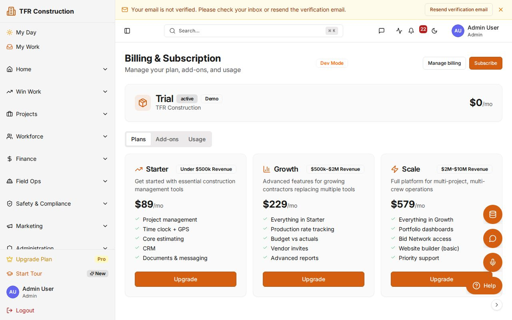

# Manage billing and plan tier

Switch plans, update your payment method, manage seat allocations, and download past invoices — all from the Billing page without contacting sales.

---

## Opening the Billing page

1. In the sidebar, click **Company Settings → Billing**, or navigate directly to **/billing**.
1. The top of the page shows:
   - Your **current plan** (Starter, Growth, or Scale) with the renewal date and next charge amount.
   - **Seats in use** — active users vs. your plan's seat limit.
   - **AI token usage** and **storage used** for the current billing period.
1. Click **Manage billing** to open the Stripe-hosted portal where you can make changes.

---

## Comparing plan tiers

| Feature | Starter | Growth | Scale |
|---|---|---|---|
| Seats | Up to 5 | Up to 25 | Custom |
| AI tokens / month | 100 K | 1 M | Custom |
| AI vision documents | 25 | 250 | Custom |
| Storage | 10 GB | 100 GB | Custom |
| Support SLA | Business hours | Priority | Dedicated |

Annual billing is available at a **15% discount** compared to 12 monthly payments. Use the monthly/annual toggle in the plan selector to compare prices before confirming.

---

## Changing your plan

1. Click **Manage billing** to open the Stripe portal.
1. Click **Update plan** and select the new tier.
1. Toggle between **Monthly** and **Annual** billing to see price differences.
1. Review the pro-rated charge (upgrade) or credit (downgrade) shown before you confirm.
1. Click **Confirm change**.
   - **Upgrades** are effective immediately — new quotas and features are available right away.
   - **Downgrades** apply at the end of the current billing period; your current plan continues until then.

---

## Updating your payment method

1. In the Stripe portal, click **Payment methods**.
1. Click **Add payment method** and enter your card number or ACH bank account details.
1. Mark the new method as **Default** to use it for all upcoming renewals.
1. Remove the old method if it is no longer needed.

---

## Downloading past invoices

1. In the Stripe portal, scroll to **Invoice history**.
1. Click the **PDF** icon next to any invoice to download it.
1. Click the invoice number to view a line-item breakdown, including taxes and pro-rated adjustments.

---

## Managing seats

**Adding a user:** go to **Company Settings → Users → Invite user**. If the invite would exceed your seat quota, it is blocked until you upgrade your plan.

**Freeing a seat:** go to **Company Settings → Users**, find the user, and click **Deactivate**. The seat is released immediately.

Seats are counted by active (non-deactivated) user accounts. Deactivated accounts retain their data but cannot log in and do not count against the quota.

---

## Failed payments and grace period

If a payment fails at renewal, the system:

1. Sends a reminder email immediately (day 0).
1. Retries and sends a follow-up at day 3.
1. Sends a final warning at day 7.
1. Suspends the account if no payment is received — existing data is preserved in read-only mode.

To restore access, open the Stripe portal, update your payment method, and click **Pay now** on the outstanding invoice. Full access is restored within seconds.

---

## Tips

- **Annual billing** saves 15% vs. monthly — the toggle is in the plan selector inside the Stripe portal.
- Your **plan tier directly determines your support SLA response times** — see [/sla](/sla) for the full tier comparison table.
- Scale customers with custom quota needs (seats, AI tokens, storage) should contact their account manager rather than using the self-serve portal.
- For a deeper walkthrough of the portal — including adding seats, dunning resolution, and quota overages — see [Manage your plan via the self-serve billing portal](/help/billing-portal).

---

Need more help? Use the **?** widget at the bottom-right of any page to open a support ticket. See [/sla](/sla) for response-time targets by plan.
