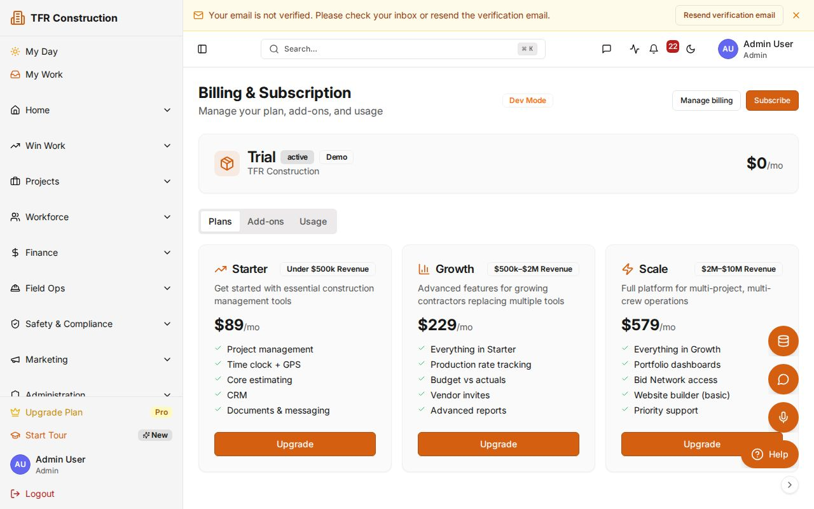
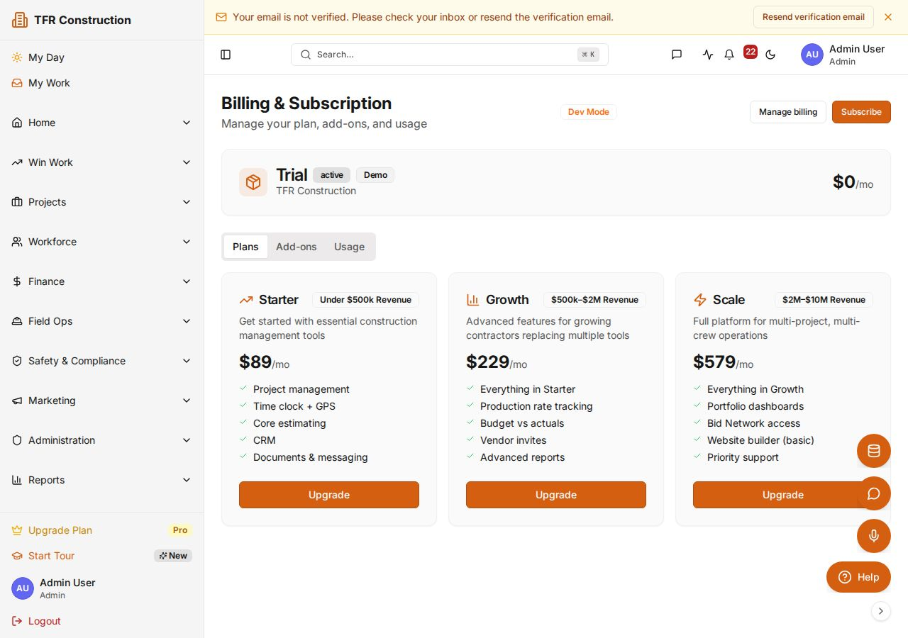

# Manage your plan via the self-serve billing portal

Switch plans, update payment details, add or remove seats, and download invoices any time — no sales call required. Billing is handled through a Stripe-hosted portal that opens directly from within SmartManageAI.

---

## Accessing the billing portal

1. In the sidebar, click **Company Settings → Billing**, or navigate directly to **/billing**.
1. The Billing overview page shows:
   - Your **current plan** (Starter, Growth, or Scale)
   - **Seats in use** vs. your plan's seat quota
   - **AI token usage** and **storage used** for the current billing period
   - **Next renewal date** and amount
1. Click **Manage billing** to open the Stripe-hosted portal in a new tab.

If the **Manage billing** button is not visible, your organization has not yet been migrated to Stripe self-serve. Click **Set up billing** to complete the one-time migration — you will be prompted to enter a payment method and the migration takes effect immediately.

---

## Understanding your current usage

Before making any plan changes, review your usage metrics on the overview page:

- **Seats** — the number of active user accounts against your plan limit. Deactivated users do not count toward the seat quota.
- **AI tokens** — cumulative tokens consumed across all AI features (estimator drafts, document analysis, chat completions) in the current billing period. Resets at each renewal.
- **AI vision documents** — number of plan documents processed by the AI Estimator against your plan limit.
- **Storage (GB)** — total file storage used across all uploaded documents, photos, and plan sets.

---

## Changing your plan

1. Inside the Stripe portal, click **Update plan**.
1. The plan selector shows **Starter**, **Growth**, and **Scale** tiers with feature and quota differences.
1. Use the **Monthly / Annual** toggle to compare billing frequencies. Annual billing saves 15% compared to 12 monthly payments.
1. Select the new plan. A summary shows the pro-rated charge or credit for the remainder of the current period.
1. Click **Confirm change**.
   - **Upgrades** take effect immediately — new seat quota, AI token quota, and feature access are available right away.
   - **Downgrades** apply at the end of the current billing period. Until then, you retain your current plan's features and limits.

---

## Updating payment details

1. In the Stripe portal, click **Payment methods**.
1. Click **Add payment method** and enter a new card number or bank account (ACH) details.
1. Set the new method as **Default** to use it for all future renewals.
1. Optionally remove the old payment method by clicking the **···** menu next to it and selecting **Remove**.

Changes apply to the next renewal automatically. Existing invoices that have already been charged are not affected.

---

## Downloading invoices

1. In the Stripe portal, scroll to **Invoice history**.
1. Each invoice shows the billing date, amount, and status (Paid / Open / Void).
1. Click the **PDF** icon to download any invoice.
1. Click the invoice number to view a full breakdown including line items and tax.

Invoices are generated at each renewal and at the time of any mid-cycle plan change or seat adjustment.

---

## Adding and removing seats

Seats are controlled through user management, not directly in the Stripe portal.

**To add a seat:**
1. Go to **Company Settings → Users → Invite user**.
1. If the invitation would exceed your current seat quota, the invite is blocked and a message prompts you to upgrade your plan.
1. Upgrade your plan first (see above), then send the invitation.

**To free a seat:**
1. Go to **Company Settings → Users**.
1. Find the user you want to remove and click **Deactivate**. The seat is released immediately and the deactivated user loses access.

---

## Dunning and failed payments

If your payment method fails at renewal:

1. An email is sent immediately (day 0) with a link to update your payment details.
1. A reminder is sent at day 3 if the payment has not been resolved.
1. A final reminder is sent at day 7.
1. If no payment is received within the grace period, the account is suspended — read-only access is maintained until the balance is cleared.

To restore access:
1. Open the Stripe portal and update your payment method.
1. In the portal, click **Pay now** next to the outstanding invoice.
1. Full access is restored within seconds of successful payment.

---

## Plan limits and overages

SmartManageAI uses hard quotas, not overages. When a limit is reached:

| Limit reached | What happens |
|---|---|
| Seat quota | New user invites are blocked until the plan is upgraded. |
| AI token quota | AI Estimator drafts and AI document analysis are paused for the remainder of the period. |
| AI vision documents | AI Estimator plan analysis is paused; manual estimating is unaffected. |
| Storage quota | New file uploads are blocked. Existing files remain accessible. |

Quotas reset at each billing renewal. Scale customers can request per-org quota overrides from their account manager.

---

## Tips

- Annual billing saves 15% — use the monthly/annual toggle in the plan selector when comparing prices.
- Your plan tier directly determines your support SLA response times. See [/sla](/sla) for the full tier comparison.
- If you are on the Scale plan, contact your account manager for custom seat counts, AI quota increases, or dedicated storage allocations rather than using the self-serve portal.

---

Need more help? Use the **?** widget to open a support ticket. See [/sla](/sla) for response-time targets by plan.
