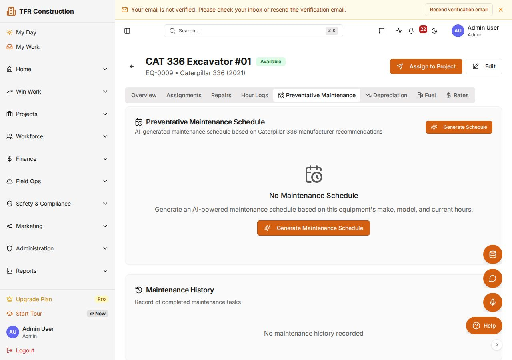
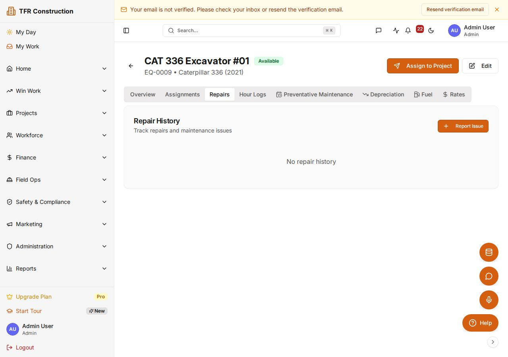
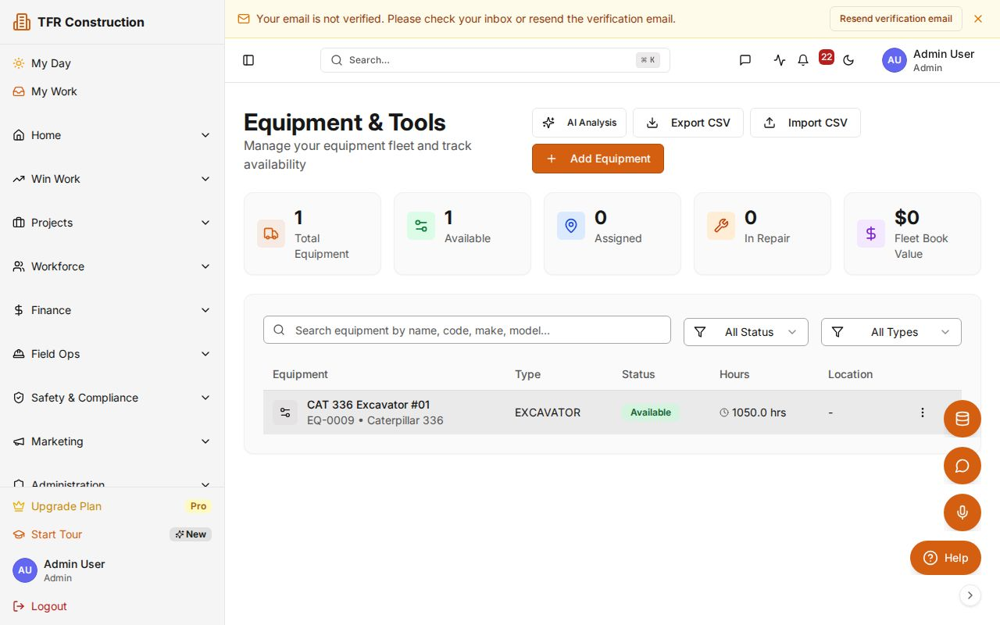
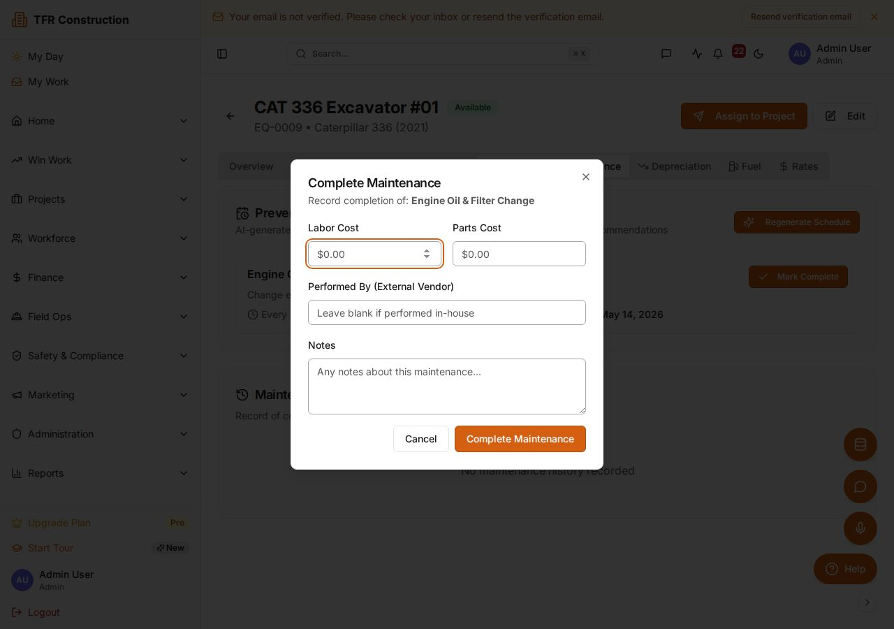

# Generate and manage PM work orders

The PM Work Order Engine reads your active preventive-maintenance schedules and automatically creates work orders when service is due — by hours, mileage, or calendar interval. Duplicate work orders for the same cycle are prevented at the database level, so you will never see the same PM appear twice even if you trigger generation multiple times.

---

## Setting up a maintenance schedule

Before work orders can be generated, each piece of equipment needs at least one maintenance schedule.

1. Navigate to **/equipment** in the sidebar.
1. Click the piece of equipment you want to schedule.
1. Open the **Maintenance** tab on the equipment detail page, then click **Add schedule**.
1. Fill in the schedule details:
   - **Description** — a short label that appears on the work order card (e.g., "250-hour oil and filter change").
   - **Trigger type** — choose one:
     - **Hours** — fires when the hour-meter reading reaches the next threshold (e.g., every 250 engine hours).
     - **Miles / km** — fires when the odometer reaches the next threshold.
     - **Calendar** — fires after a fixed number of days regardless of usage (e.g., every 90 days).
   - **Interval** — the numeric value for the chosen trigger (e.g., `250` for every 250 hours).
   - **First due date / reading** — when the first PM should occur. Subsequent due dates are calculated automatically after each PM is marked completed.
1. Optionally assign a **Default technician** so generated work orders are pre-assigned.
1. Click **Save**.

You can add multiple schedules to one piece of equipment — for example, a 250-hour oil change and a 1,000-hour major service on the same machine.

---

## Generating work orders

Work orders are generated automatically every night by the system's PM engine. To run generation on demand:

1. Go to **Equipment → Work Orders** in the sidebar.
1. Click **Generate now** at the top right.
1. The engine checks every active schedule across all equipment and reports results:
   - **Created** — new work orders written for due PMs.
   - **Skipped (already open)** — a work order for this PM cycle already exists; no duplicate was created.
   - **Not yet due** — the trigger threshold has not been reached.

If a schedule's due date or reading passes while a work order is still open, the engine does not create a second work order for the same cycle. Once the open work order is marked **Completed**, the next cycle becomes eligible.

---

## Reviewing and managing open work orders

1. Open **Equipment → Work Orders**. The list shows all open PMs across all equipment.
1. Use the **Filter** bar to narrow by equipment, trigger type, assigned technician, or status.
1. Each work order card shows:
   - Equipment name and ID
   - Schedule description (e.g., "250-hour oil and filter change")
   - Due date or due reading
   - Current status: **Pending**, **In Progress**, or **Completed**
   - Assigned technician

---

## Working a work order

1. Click a work order card to open the detail view.
1. Change status to **In Progress** when work begins.
1. Log the following as the PM is performed:
   - **Labor** — technician name, hours worked, and labor cost code.
   - **Parts used** — select materials from the inventory catalog. Parts are deducted from on-hand stock at the selected location automatically.
   - **Notes** — observations, torque specs met, fluids topped, or any anomalies found.
   - **Current reading** — update the hour-meter or odometer to the actual reading at the time of service.
1. When all work is done, click **Mark completed**.

Marking a work order **Completed** does two things automatically:
- The schedule's **Next due date / reading** advances by the interval (e.g., from 1,000 hours to 1,250 hours).
- If parts were logged, the corresponding inventory transactions are posted.

---

## Understanding the PM cycle key

Each work order is tied to a specific PM cycle identified by the schedule and the due date (or due-reading snapshot). This prevents a race condition where two simultaneous "Generate now" runs create duplicate work orders. If you trigger generation twice within the same night, only one work order is created for each due cycle — the second run sees the existing open record and counts it as **Skipped (already open)**.

---

## Rental return reminders

For rented equipment, the PM engine generates a reminder work order 7 days before the rental end-date. The work order description reads "Rental return due in 7 days" and is assigned to the equipment manager. This gives you time to schedule pickup or negotiate an extension before automatic fees begin.

---

## Troubleshooting

| Symptom | What to check |
|---|---|
| Work order not generated for a due PM | Confirm the schedule is **Active** (not paused or deleted) and the current reading or date has passed the due threshold. |
| Schedule triggers unexpectedly early | Compare the **Due reading** on the schedule against the **Current hour-meter** on the equipment record — a backdated meter entry can push a schedule into the due window early. |
| Duplicate work orders visible | These are from before the idempotency enforcement. They can be safely closed; future generation will not create new duplicates for completed cycles. |

---

Need more help? Use the **?** widget to open a support ticket. See [/sla](/sla) for response-time targets by plan.
