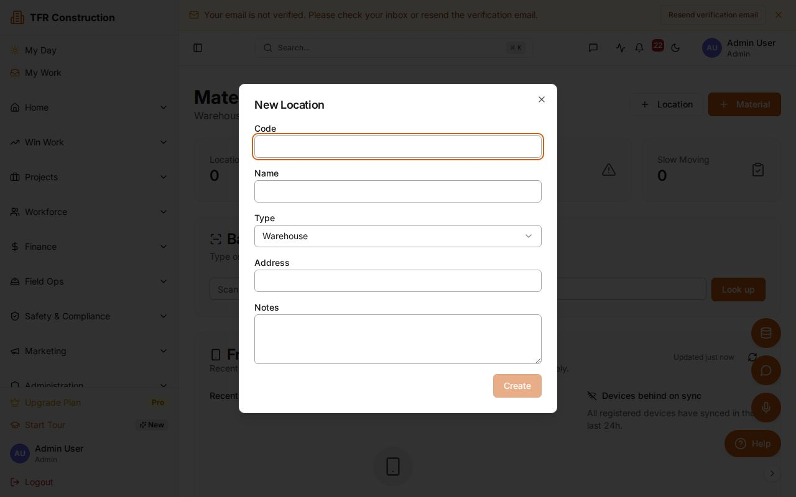
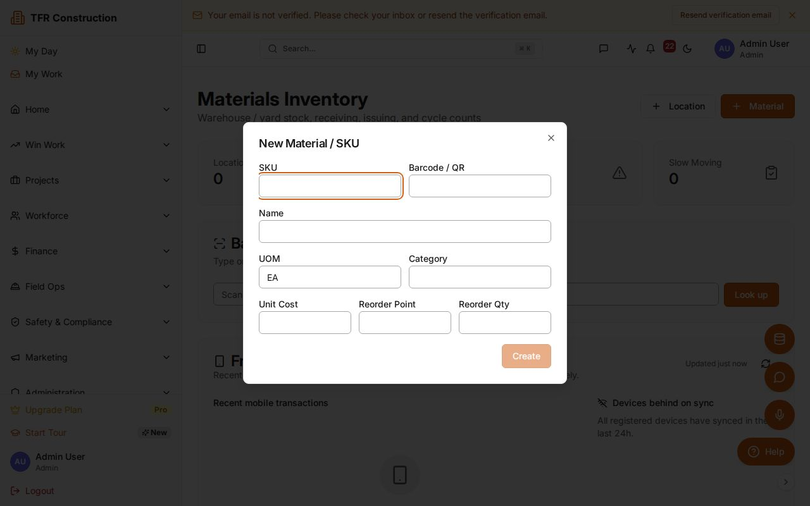
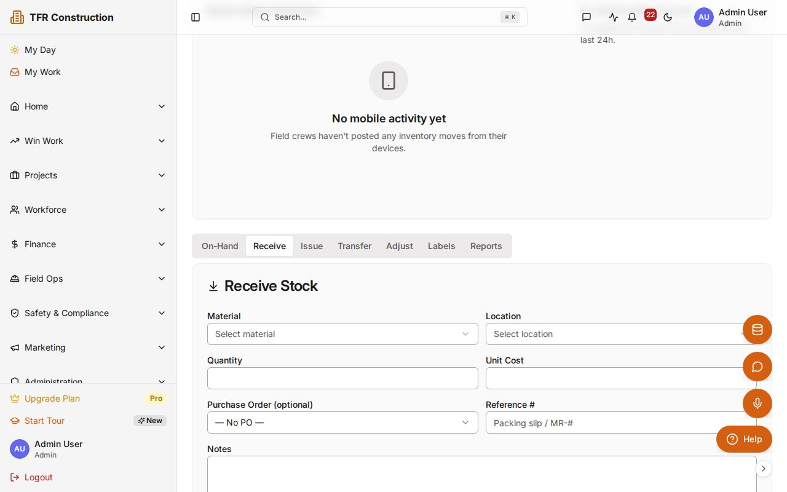
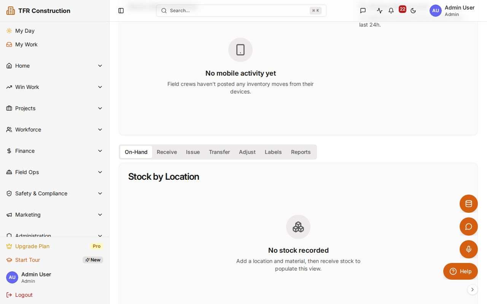

# Materials Inventory overview

Track materials across every location — warehouse, yard, jobsite, and truck — with a full stock ledger, automatic project cost burden, and low-stock alerts. This guide walks you through the complete workflow from first setup through cycle counts and reporting.

---

## Setting up locations

Before recording any stock, create the physical locations where materials are stored.

1. Navigate to **/inventory** in the sidebar.
1. Click the **Locations** tab, then **Add location**.
1. Choose a location **Type**: `Warehouse`, `Yard`, `Jobsite`, or `Truck`.
1. Enter a short **Code** (e.g., `WH-01`) and a human-readable **Name** (e.g., `Main Warehouse`).
1. Click **Save**. The location appears in the list immediately.

Repeat for each physical storage area. You can add jobsite locations as new projects start and deactivate them when a project closes.

---

## Adding materials to the catalog

1. Click the **Materials** tab, then **Add material**.
1. Fill in the required fields:
   - **SKU** — your internal part number or supplier code.
   - **Name** — a clear description (e.g., "1/2-in. rebar, 20-ft stick").
   - **Unit of measure** — `EA`, `LF`, `CY`, `SF`, `TON`, etc.
   - **Default cost code** — the cost code that receives the burden when the material is issued to a project.
1. Optional but recommended:
   - **Barcode / QR payload** — scan-ready value so field staff can look up the material instantly with the mobile app camera or a Bluetooth scanner.
   - **Reorder point** — quantity at or below which a low-stock alert fires.
   - **Reorder quantity** — suggested order size shown on the Low-Stock Report.
1. Click **Save**.

---

## Receiving materials

Use **Receive** whenever materials arrive from a supplier or are returned from a jobsite.

1. Click **Transactions → Receive**.
1. Select the **Destination location** (e.g., `WH-01`).
1. Optionally link to an open **Purchase Order line** — the received quantity is posted back to `purchaseOrderItems.quantityReceived` automatically.
1. Choose the **Material** from the catalog (or scan its barcode).
1. Enter the **Quantity** and **Unit cost** for this delivery.
1. Click **Post**. On-hand stock at the selected location increases immediately, and a transaction record is created in the ledger.

---

## Issuing materials to projects

When materials leave a location for use on a project, issue them so the cost flows to the project budget.

1. Click **Transactions → Issue to project**.
1. Select the **Source location** and the **Material** (or scan the barcode).
1. Enter the **Quantity** being issued.
1. Pick the **Project** and the **Cost code** (defaults to the material's default cost code but can be changed per issue).
1. Click **Post**. On-hand decreases at the source location and the material cost — calculated from the running average unit cost — is applied to the project budget line.

---

## Transferring stock between locations

1. Click **Transactions → Transfer**.
1. Select the **Source location** and **Destination location**.
1. Choose the **Material** and enter the **Quantity**.
1. Click **Post**. Two linked transactions are created — a `TRANSFER_OUT` at the source and a `TRANSFER_IN` at the destination — keeping the ledger balanced across locations.

---

## Adjusting inventory

Managers and Admins can post a manual adjustment to correct discrepancies discovered outside a formal cycle count.

1. Click **Transactions → Adjust**.
1. Select the **Location** and **Material**.
1. Enter the **Adjusted quantity** (positive to add, negative to remove).
1. Choose an **Adjustment reason** from the dropdown (e.g., `Damaged`, `Theft`, `Data entry error`).
1. Click **Post**. The adjustment is recorded in the ledger with the reason for full audit traceability.

---

## Running a cycle count

A cycle count lets you reconcile physical quantities against system records for a location.

1. Click **Cycle Counts → Start count** and select the **Location** to count.
1. The system generates a count sheet listing every material with on-hand stock at that location.
1. Walk the location and enter the **Physical count** for each line. Variances (system vs. physical) are calculated in real time.
1. Review the variance summary, then click **Submit for approval**.
1. A Manager or Admin receives the approval request. On **Approve**, variance adjustments are posted automatically with reason code `CYCLE_COUNT`. On **Reject**, the count returns to draft for correction.

---

## Low-stock alerts and reports

- Materials at or below their reorder point appear on the **Low-Stock Report** under **Reports → Low Stock**.
- Each row shows current on-hand, reorder point, reorder quantity, and the location affected.
- The **Slow-Moving Report** (under **Reports → Slow Moving**) lists materials with no transaction activity in the last 90 days, helping identify overstock.

---

## Barcode lookup

From the mobile app, tap **Scan** and point the camera at any barcode or QR code on a material. The app opens the material record directly — useful for issuing or transferring stock without typing.

Alternatively, from a desktop browser, use **Materials → Search by barcode** and type or paste the code.

---

Need more help? Use the **?** widget to open a support ticket. See [/sla](/sla) for response-time targets by plan.
