# Mobile Workflows

> Part of the [Mobile App Architecture Blueprint](./README.md). Diagrams the
> cross-cutting flows referenced throughout `01-architecture.md` and the
> `features/` docs. Mermaid diagrams render natively in GitHub/most doc
> viewers.

## 1. Login (OAuth mobile-exchange + passkey)

Authoritative source: `docs/api/mobile-auth.md`. This sequence summarizes
it for orientation only — refer to that doc for exact endpoint contracts.

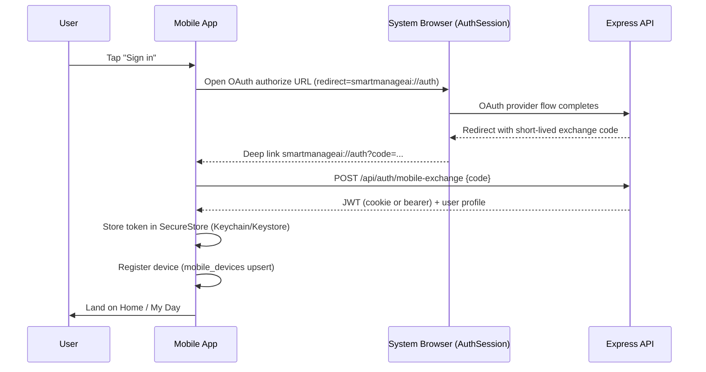

Passkey login follows the WebAuthn ceremony documented in
`docs/api/mobile-auth.md` §3, substituting the platform authenticator
(Face ID / fingerprint / device PIN) for the OAuth browser hop.

## 2. Offline field-data capture → sync (general shape)

This is the shape shared by every `APPEND_ONLY` / `MERGE_FIELDS` /
`DEDUPLICATE_WINDOW` entity (daily reports, photos, punch items, safety
observations, haul tickets, time clock events):

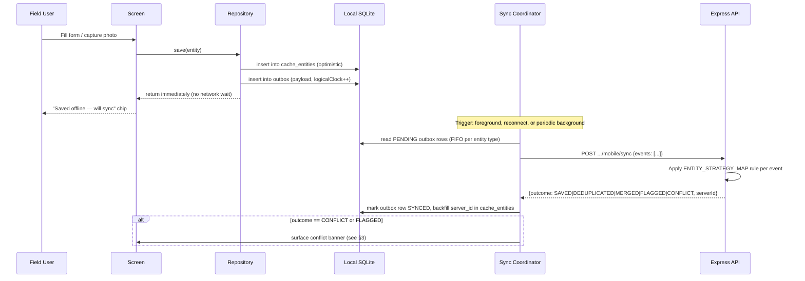

## 3. Conflict surfacing (FLAG_BOTH / CONFLICT outcomes)

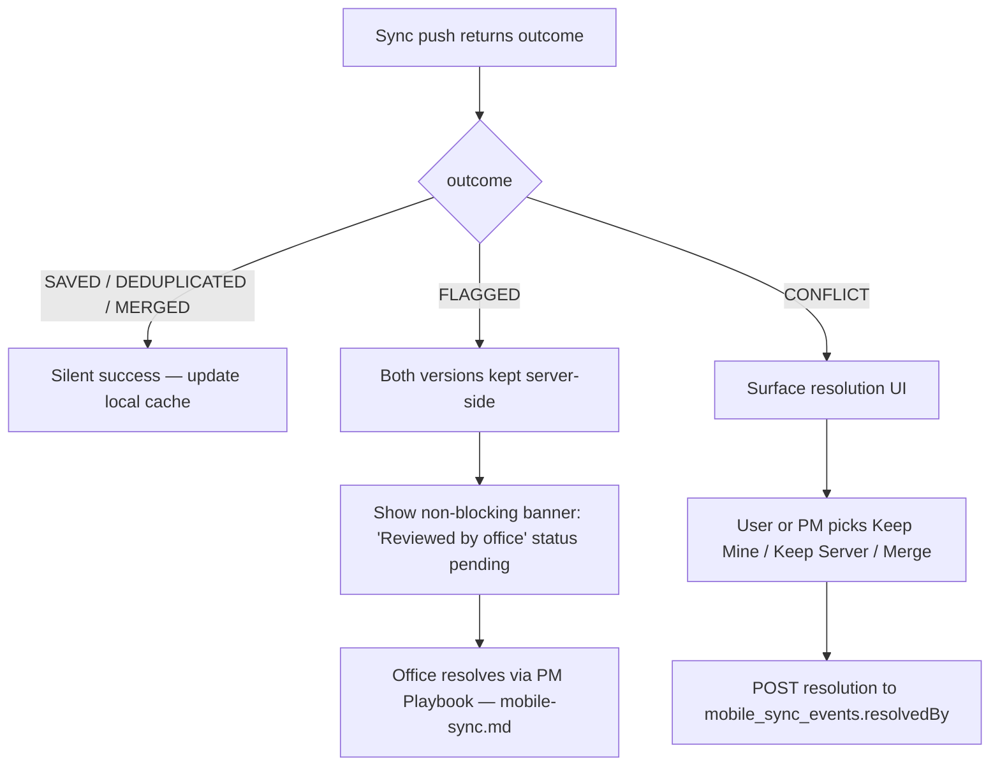

Per `00-overview.md` principle 5, the app never auto-resolves a `FLAG_BOTH`
or `CONFLICT` outcome silently — every one of these outcomes is visible to
a human, either the field user immediately or the office via the PM
playbook in `docs/architecture/mobile-sync.md`.

## 4. Time clock clock-in/out (payroll-critical path)

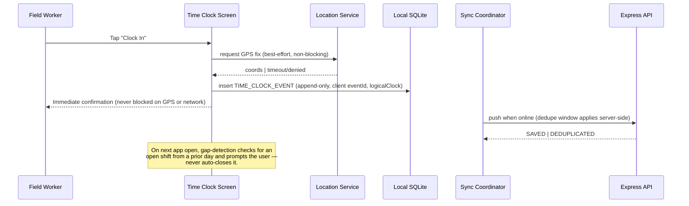

## 5. Approval / money-path action (online-only)

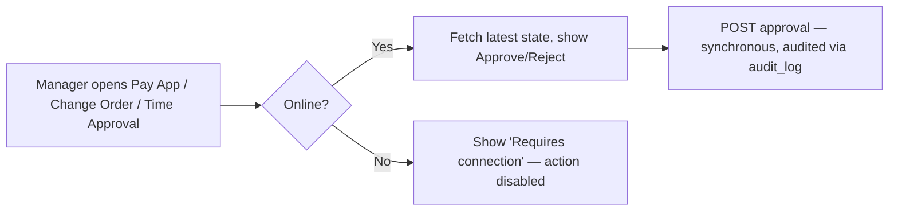

This flow applies uniformly to change-order approval, AIA pay application
approval, T&M ticket approval, and MFA enable/disable — see each feature
doc's §3 for the specific entity.

## 6. Push notification → deep link

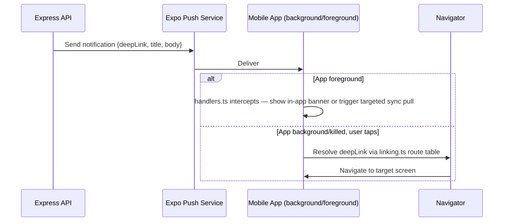

## 7. App launch → auth check → sync bootstrap

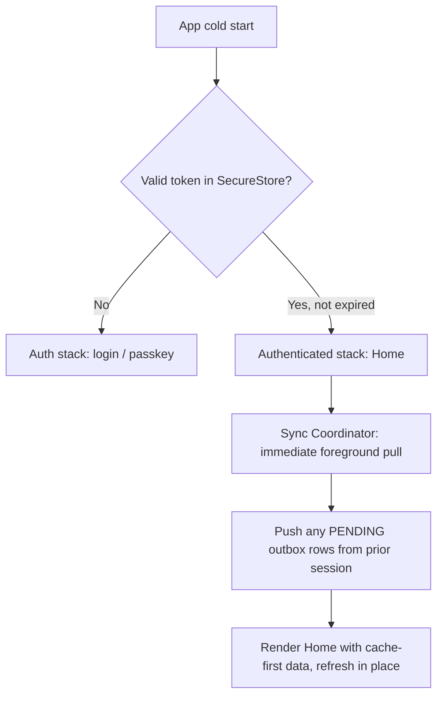

## 8. Project lifecycle (mobile view)

Web owns project creation/close-out (`docs/mobile/features/projects.md`
§6 gaps); mobile's role in the lifecycle is status-transition visibility,
field-data capture during the active phase, and read access to bid/estimate
provenance. Failure/recovery paths shown for the two transitions mobile can
actually trigger.

```mermaid
stateDiagram-v2
    [*] --> Bid_Won: Won on web (ESTIMATOR/MANAGER) — mobile: read-only notification
    Bid_Won --> Active: PM sets status=ACTIVE (web-only transition)
    Active --> Active: Daily notes / RFIs / punch list / photos / time clock (full mobile capture, offline-first)
    Active --> On_Hold: MANAGER/ADMIN sets status=ON_HOLD (web or mobile — see below)
    On_Hold --> Active: Resume (web or mobile)
    Active --> Closeout: PM initiates close-out (web-only — desktop-density checklist)
    Closeout --> Complete: Final sign-off (web-only)
    Complete --> [*]

    note right of Active
        Mobile-triggerable transition: Active <-> On_Hold via
        PATCH /api/projects/:id/status (MANAGER/ADMIN/SUPERINTENDENT-assigned).
        Success: optimistic local status flip, confirmed on next sync pull.
        Failure (409 stale status / RLS reject): revert local flip, toast
        "Project status changed elsewhere — refreshed", re-pull latest.
        Recovery: user retries from the now-current state; no silent retry
        loop to avoid double-transitioning a project.
    end note
```

Mobile never initiates Bid→Active or Closeout→Complete — those remain
desktop-density workflows per `docs/mobile/features/projects.md` §6 and
`docs/mobile/00-overview.md` §6.

## 9. Estimate / takeoff lifecycle (mobile view)

Full AI takeoff creation and CSI-division scoping remain desktop-only
(`docs/mobile/features/sales-win-work.md` §6) — sheet markup needs a
large canvas and a stable network connection for the Anthropic-routed
extraction call (`docs/architecture/ai-provider-routing.md`). Mobile's
role is status visibility, read access to line items, and a narrow
online-only quantity-adjustment action for ESTIMATOR/MANAGER while in
the field walking a site.

```mermaid
sequenceDiagram
    participant U as Estimator (mobile)
    participant App as Mobile App
    participant API as Express API
    participant AI as Anthropic (Takeoff routing)

    Note over U,AI: Sheet upload, AI takeoff run, and CSI scoping happen on web only.
    U->>App: Open Estimate detail (read)
    App->>API: GET /api/estimates/:id (cached; requires online for first load)
    API-->>App: Line items, takeoff status, CSI divisions
    alt Estimator adjusts a quantity in the field
        U->>App: Edit quantity on a line item
        App->>API: PATCH /api/estimates/:id/line-items/:lineId (online-only, no offline queue)
        alt Success
            API-->>App: 200 updated line item
            App->>U: Inline confirmation
        else Failure (network / 409 concurrent edit)
            API-->>App: Error
            App->>U: "Couldn't save — check connection and retry" (no silent drop, no offline queue for money-adjacent estimate data)
        end
    else No connection
        App->>U: Field disabled, "Requires connection to edit estimate line items"
    end
```

Recovery: because estimate line items feed bid pricing (a money path per
`threat_model.md` §2), this action is deliberately **not** offline-queued
— an edit either lands synchronously or the user is told plainly it did
not, matching the online-only pattern in workflow §5.

## 10. AI workflow (mobile-triggered)

Mobile can trigger a narrow set of already-governed AI actions (e.g. daily
note summarization, RFI draft-response suggestion) — never raw prompt
entry, and always through the same `governedAiCall` / prompt-injection
guard path used by web (`docs/architecture/prompt-injection.md`,
`threat_model.md` §5.6). No new AI provider or route is introduced for
mobile.

```mermaid
sequenceDiagram
    participant U as Field User
    participant App as Mobile App
    participant API as Express API
    participant Guard as promptInjectionGuard
    participant LLM as OpenAI/Anthropic (routed)

    U->>App: Tap "Summarize" / "Suggest response" on an existing record
    App->>API: POST /api/ai/.../analyze {recordId} (existing route, reused as-is)
    API->>Guard: Wrap record text in quarantine envelope, run detectPromptInjection
    alt Injection pattern flagged/refused
        Guard-->>API: refuse or quarantine
        API-->>App: 422 / sanitized response
        App->>U: "This document couldn't be summarized" (no silent pass-through)
    else Clean
        Guard-->>API: proceed
        API->>LLM: governedAiCall (spend/action caps enforced)
        LLM-->>API: JSON output (schema-validated via validateAiJsonOutput)
        API-->>App: Structured suggestion
        App->>U: Render suggestion; user must explicitly accept before it writes any field
    end
```

Failure/recovery: a governance-cap rejection (org over its per-org AI
spend/action limit) returns a distinct 429-style error the app surfaces
as "AI limit reached for your organization" — never retried silently,
since silent retries would defeat the spend cap's purpose.

## 11. CRM workflow (mobile-triggered)

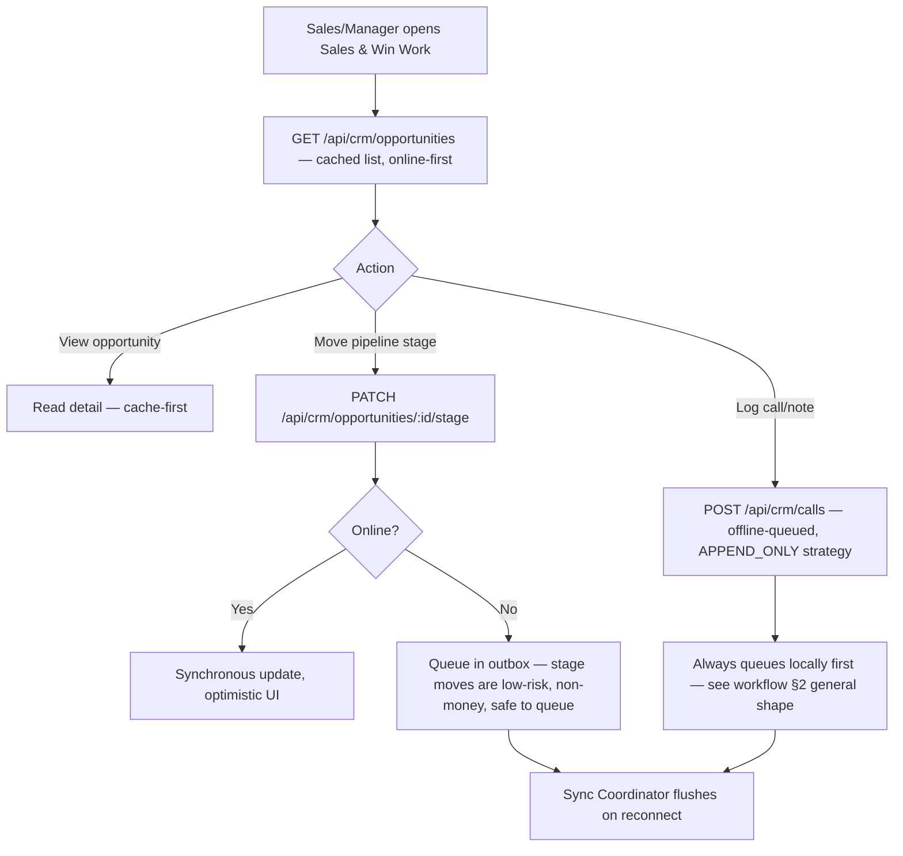

Stage moves and call logs are the two CRM actions safe to queue offline
(no financial commitment). CRM entities are not yet present in
`ENTITY_STRATEGY_MAP` (`shared/schema/features/mobileSync.ts`) —
`docs/mobile/features/sales-win-work.md` §3 flags the proposed
`LAST_WRITE_WINS` (stage) / `APPEND_ONLY` (call/note) strategies as a
gap-vs-today, not shipped behavior. Opportunity creation and proposal
generation remain web-only per
`docs/mobile/features/sales-win-work.md` §6.

## 12. Marketing workflow (mobile view)

Marketing (campaign creation, lead-source configuration, CRM analytics
authoring) is a desktop-density, non-field workflow with no offline
requirement — mobile is **read-only** for the `MARKETING` role (which
maps to `MANAGER` per `00-overview.md` §4.1).

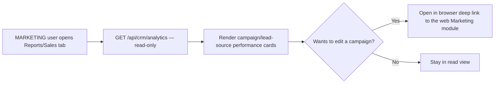

No write path exists for marketing entities on mobile in v1 — this is a
deliberate scope decision (`00-overview.md` §6), not a gap.

## 13. Subscription / billing workflow (mobile view)

Company-level subscription and billing-plan management (Super Admin /
ADMIN billing settings) is desktop-density and stays web-only. The only
mobile-relevant billing surface is a read-only "your plan" glance for
ADMIN, so an org owner isn't blind on mobile if a plan issue needs
attention.

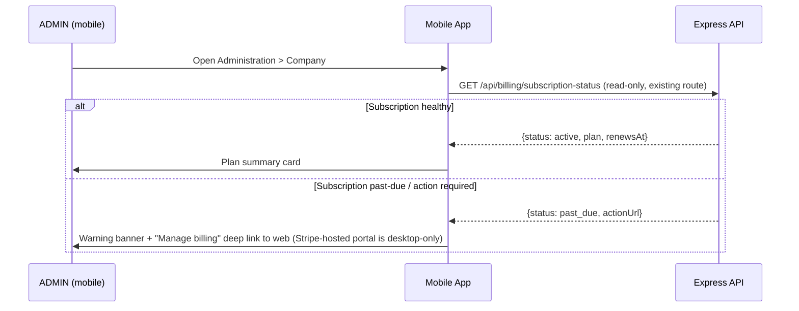

Recovery: mobile never attempts to collect a payment method or process a
billing action itself — every remediation path deep-links to the existing
web billing settings page, consistent with `00-overview.md` §6's
"desktop-density modules" principle.

## 14. Document handling workflow (upload → scan → availability)

Applies uniformly to daily-report photos, RFI attachments, safety
incident photos, and any other mobile-originated upload. Authoritative
scan boundary: `threat_model.md` §5.4.

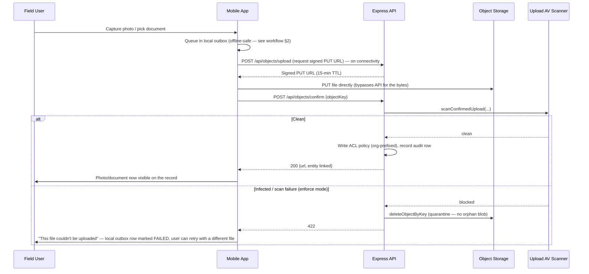

Recovery: a FAILED outbox row is never silently retried with the same
file (it would fail the same scan again); the app surfaces it in the
user's pending-uploads list so they can discard or re-capture, consistent
with the "explicit, visible failure over silent data loss" principle in
`00-overview.md` §5.
