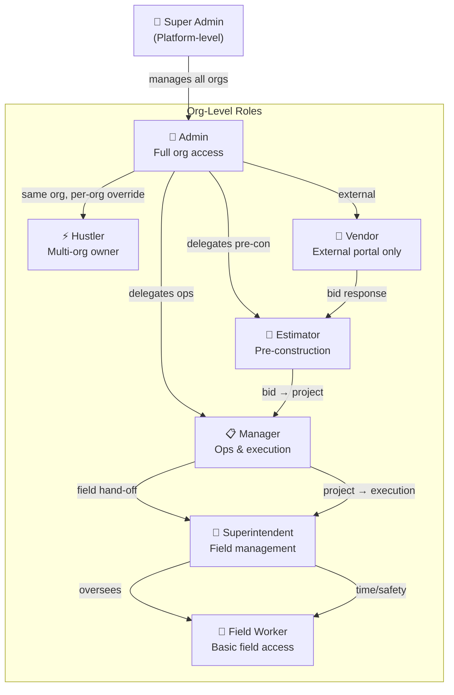
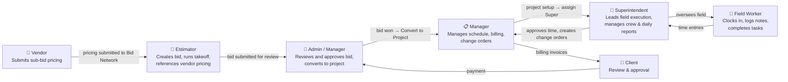
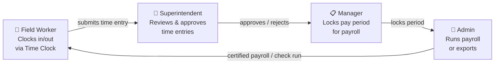
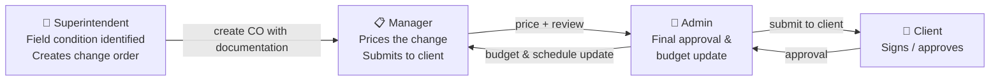
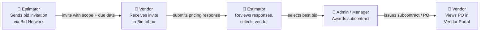
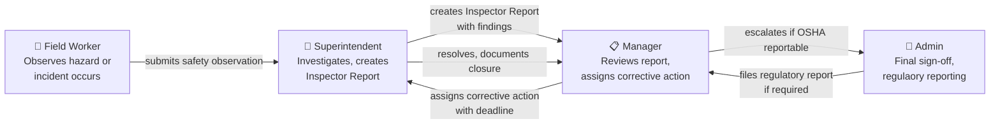

# SmartManageAI — User Role Business Flows

> **Source of truth:** `server/rolePermissions.ts` (authoritative permission flags) and `client/src/lib/rbac.ts` (hierarchy and display names).  
> This document covers **role defaults only**. Org admins may grant per-user overrides on top of these defaults.

---

## Table of Contents

1. [Role Hierarchy Overview](#role-hierarchy-overview)
2. [Feature Access Matrix](#feature-access-matrix)
3. [Super Admin](#1-super-admin)
4. [Admin](#2-admin)
5. [Hustler](#3-hustler)
6. [Manager](#4-manager)
7. [Estimator](#5-estimator)
8. [Superintendent](#6-superintendent)
9. [Field Worker](#7-field-worker)
10. [Vendor](#8-vendor)
11. [Cross-Role Workflows](#cross-role-workflows)

---

## Role Hierarchy Overview



**Hierarchy order (highest → lowest):**  
`SUPER_ADMIN > ADMIN > HUSTLER > MANAGER > SUPERINTENDENT > ESTIMATOR > FIELD_WORKER > VENDOR`

---

## Feature Access Matrix

`✅` = full access · `👁` = view only · `📝` = create/edit (no delete/admin) · `❌` = no access

| Feature Area | Super Admin | Admin | Hustler | Manager | Estimator | Superintendent | Field Worker | Vendor |
|---|:---:|:---:|:---:|:---:|:---:|:---:|:---:|:---:|
| **Dashboard / My Day** | ✅ | ✅ | ✅ | ✅ | ✅ | ✅ | ✅ | ✅ |
| **Bids — View** | ✅ | ✅ | ✅ | ✅ | ✅ | 👁 | ❌ | ❌ |
| **Bids — Edit / Create** | ✅ | ✅ | ✅ | ✅ | ✅ | ❌ | ❌ | ❌ |
| **Bids — Delete** | ✅ | ✅ | ✅ | ✅ | ❌ | ❌ | ❌ | ❌ |
| **Takeoff** | ✅ | ✅ | ✅ | ✅ | ✅ | 👁 | ❌ | ❌ |
| **AI Bid Analysis** | ✅ | ✅ | ✅ | ✅ | ✅ | ❌ | ❌ | ❌ |
| **AI Estimator** | ✅ | ✅ | ✅ | ✅ | ✅ | ❌ | ❌ | ❌ |
| **Bid Network (as GC)** | ✅ | ✅ | ✅ | ✅ | ✅ | ❌ | ❌ | ❌ |
| **Bid Network Inbox** | ✅ | ✅ | ✅ | ✅ | ✅ | ❌ | ❌ | ✅ |
| **Convert Bid → Project** | ✅ | ✅ | ✅ | ✅ | ✅ | ❌ | ❌ | ❌ |
| **Projects — View** | ✅ | ✅ | ✅ | ✅ | ✅ | ✅ | ✅ (active only) | ❌ |
| **Projects — Create/Edit** | ✅ | ✅ | ✅ | ✅ | ✅ | ❌ | ❌ | ❌ |
| **Change Orders** | ✅ | ✅ | ✅ | ✅ | ❌ | ✅ | ❌ | ❌ |
| **Project Financials — View** | ✅ | ✅ | ✅ | ✅ | ✅ | ✅ | ❌ | ❌ |
| **Project Financials — Edit** | ✅ | ✅ | ✅ | ❌ | ❌ | ❌ | ❌ | ❌ |
| **CFO Dashboard** | ✅ | ✅ | ✅ | ✅ | ❌ | ✅ | ❌ | ❌ |
| **T&M Billing** | ✅ | ✅ | ✅ | ✅ | ❌ | ❌ | ❌ | ❌ |
| **Progress Billing** | ✅ | ✅ | ✅ | ✅ | ❌ | ❌ | ❌ | ❌ |
| **Subcontracts** | ✅ | ✅ | ✅ | ✅ | ❌ | ✅ | ❌ | ❌ |
| **Overhead Costs** | ✅ | ✅ | ✅ | ✅ | ❌ | ❌ | ❌ | ❌ |
| **Cost Rates** | ✅ | ✅ | ✅ | ❌ | ✅ | ❌ | ❌ | ❌ |
| **Historical Costs** | ✅ | ✅ | ✅ | ✅ | ✅ | ❌ | ❌ | ❌ |
| **Time Clock — Use** | ✅ | ✅ | ✅ | ✅ | ✅ | ✅ | ✅ | ❌ |
| **Time Clock — Manage/Approve** | ✅ | ✅ | ✅ | ✅ | ❌ | ✅ | ❌ | ❌ |
| **Payroll** | ✅ | ✅ | ✅ | ✅ | ❌ | ❌ | ❌ | ❌ |
| **Crews** | ✅ | ✅ | ✅ | ✅ | ❌ | ✅ | ❌ | ❌ |
| **Workforce Management** | ✅ | ✅ | ✅ | ✅ | ❌ | ✅ | ❌ | ❌ |
| **Hiring / HR** | ✅ | ✅ | ✅ | ✅ | ❌ | ❌ | ❌ | ❌ |
| **Safety Training** | ✅ | ✅ | ✅ | ✅ | ❌ | ✅ | 👁 | ❌ |
| **Scheduling / Dispatch** | ✅ | ✅ | ✅ | ✅ | ❌ | ✅ | ❌ | ❌ |
| **Equipment** | ✅ | ✅ | ✅ | ✅ | ✅ | ✅ | ❌ | ❌ |
| **Procurement** | ✅ | ✅ | ✅ | ✅ | ✅ | ✅ | ❌ | ❌ |
| **CRM** | ✅ | ✅ | ✅ | ✅ | ✅ | ✅ | ❌ | ❌ |
| **Marketplace** | ✅ | ✅ | ✅ | ✅ | ✅ | ❌ | ❌ | ❌ |
| **Inspector Reports** | ✅ | ✅ | ✅ | ✅ | ❌ | ✅ | 📝 (submit) | ❌ |
| **SWPPP** | ✅ | ✅ | ✅ | ✅ | ❌ | ✅ | 👁 | ❌ |
| **Haul Tickets** | ✅ | ✅ | ✅ | ✅ | ❌ | ✅ | 👁 | ❌ |
| **DBE Goals** | ✅ | ✅ | ✅ | ✅ | ✅ | ✅ | ❌ | ❌ |
| **DOT Pay Item Library** | ✅ | ✅ | ❌ | ❌ | 👁 | 👁 | ❌ | ❌ |
| **Compliance Dashboard** | ✅ | ✅ | ✅ | ✅ | ❌ | ✅ | ❌ | ❌ |
| **Surety Bonds** | ✅ | ✅ | ✅ | ✅ | ✅ | 👁 | ❌ | ❌ |
| **Material Certifications** | ✅ | ✅ | ✅ | ✅ | 👁 | ✅ | ❌ | ❌ |
| **Reports** | ✅ | ✅ | ✅ | ✅ | ✅ | ✅ | ❌ | ❌ |
| **KPIs** | ✅ | ✅ | ✅ | ✅ | ❌ | ✅ | ❌ | ❌ |
| **CRM / Social Media** | ✅ | ✅ | ✅ | ✅ | ❌ | ❌ | ❌ | ❌ |
| **Website Builder** | ✅ | ✅ | ✅ | ❌ | ❌ | ❌ | ❌ | ❌ |
| **Executive Digest** | ✅ | ✅ | ✅ | ❌ | ❌ | ❌ | ❌ | ❌ |
| **Company Settings** | ✅ | ✅ | ✅ | ✅ | ❌ | ❌ | ❌ | ❌ |
| **Manage Users** | ✅ | ✅ | ✅ | ❌ | ❌ | ❌ | ❌ | ❌ |
| **AI Settings** | ✅ | ✅ | ✅ | ❌ | ❌ | ❌ | ❌ | ❌ |
| **Audit Logs** | ✅ | ✅ | ✅ | ✅ | ❌ | ❌ | ❌ | ❌ |
| **Portfolio (Hustler)** | ✅ | ❌ | ✅ | ✅ | ❌ | ❌ | ❌ | ❌ |
| **Platform Admin Panel** | ✅ | ❌ | ❌ | ❌ | ❌ | ❌ | ❌ | ❌ |
| **Vendor Portal** | ❌ | ❌ | ❌ | ❌ | ❌ | ❌ | ❌ | ✅ |

---

## 1. Super Admin

### Who is this?
The **platform operator** — a SmartManageAI employee who manages the SaaS platform itself. They are never a member of a contractor organization; they live above the org layer and can see, configure, and support any tenant.

### Access Level
- Bypasses all org-level permission checks
- Has a dedicated Admin Panel separate from any org's UI
- Cannot access the Vendor Portal (that's org-specific)
- All 73 feature flags are `true` by default

### Sidebar Navigation
```
Platform
├── Dashboard (/admin)
├── Organizations (/admin/organizations)
├── Analytics (/admin/analytics)
├── Tools (/admin/tools)
└── Status (/admin/status)
```

### Business Workflows

#### 1.1 Onboard a New Organization
1. Navigate to **Admin → Organizations → Create Organization**
2. Fill in company name, plan tier, and billing details
3. Create the initial Admin user (invite email sent)
4. Optionally apply a feature flag preset to the org
5. Monitor the org's activity in the Analytics panel

#### 1.2 Manage Feature Flags
1. Navigate to **Admin → Organizations → [Select Org]**
2. Open the **Feature Flags** tab
3. Enable or disable any of the platform-level feature toggles for that org
4. Changes take effect immediately (no redeploy needed)

#### 1.3 Investigate a Support Issue
1. Navigate to **Admin → Tools** → select the relevant tool (impersonation, audit viewer, etc.)
2. Use **Audit Logs** to trace specific user actions by timestamp
3. View the **Activity Feed** to see recent cross-org events
4. Use **Admin → Status** to check system health probes

#### 1.4 Monitor Platform Health
1. Navigate to **Admin → Status** for live uptime and probe results
2. Review **Admin → Analytics** for platform-wide metrics (DAU, bid volume, job counts)
3. Respond to any degraded probes by escalating to engineering

### Permissions Summary

| Category | Access |
|---|---|
| All org features | ✅ (bypasses checks) |
| Platform admin panel | ✅ (exclusive) |
| Manage organizations | ✅ |
| Feature flags (any org) | ✅ |
| Enterprise settings | ✅ |
| Vendor portal | ❌ |
| Project scope | ALL |

---

## 2. Admin

### Who is this?
The **organization owner** — typically the business owner or principal of the construction company. They have complete control over everything inside their organization: users, settings, finances, and all operational features.

### Access Level
- Full access to all 73 feature flags (same as `ALL_TRUE`)
- Can manage users, roles, and per-user permission overrides
- Can access AI Settings, Website Builder, Executive Digest
- Can edit financials and configure enterprise settings

### Sidebar Navigation
```
My Day / My Work
├── Win Work (Sales & Estimating)
│   ├── CRM, Bids, Takeoff, AI Estimator
│   ├── Bid Network (GC view + Inbox)
│   └── Marketplace
├── Projects
│   ├── All Projects, Calendar, Tasks
│   ├── Change Orders, Submittals, RFI
│   └── Subcontracts
├── Workforce
│   ├── Users, Crews, Hiring/HR
│   ├── Time Clock, Leave, Payroll
│   └── Dispatch Board
├── Finance
│   ├── CFO Dashboard, T&M Billing
│   ├── Progress Billing, Cost Rates
│   ├── Overhead Costs, Subcontractor Payables
│   └── Historical Costs
├── Field Ops
│   ├── Equipment, Procurement, Inventory
│   ├── Lidar Scans, Permits
│   └── Production Rates
├── Safety & Compliance
│   ├── Safety Training, Compliance Dashboard
│   ├── Inspector Reports, SWPPP
│   ├── Haul Tickets, DOT Library
│   ├── DBE Goals, Material Certifications
│   └── Surety Bonds
├── Marketing
│   ├── Website Builder, Social Media
│   └── Executive Digest
└── Administration
    ├── Company Settings, Users
    ├── Cost Book, Project Templates
    ├── AI Settings, Audit Logs
    └── Approvals
```

### Business Workflows

#### 2.1 Onboard the Organization
1. Log in for the first time → complete the AI-guided walkthrough
2. Navigate to **Administration → Company Settings** to configure company name, logo, address, and fiscal settings
3. Set up **Cost Book** (labor rates, material categories, markup defaults)
4. Create **Project Templates** for recurring project types
5. Go to **Workforce → Users → Invite** to add team members and assign roles
6. Configure **AI Settings** (OpenAI key, estimator training preferences)

#### 2.2 Manage Users & Permissions
1. Navigate to **Administration → Users**
2. Click **Invite User** → enter email, select role from: Admin, Manager, Superintendent, Estimator, Field Worker, Vendor
3. To override individual permissions, open the user's profile → **Permissions** tab → toggle specific flags
4. To deactivate a user: open profile → **Deactivate** (preserves audit trail)

#### 2.3 Run the Full Bid-to-Invoice Cycle
1. **Win Work:** Estimator creates bid → Admin reviews and approves → converts to project
2. **Project Setup:** Admin assigns Superintendent and Manager → sets budget and schedule baseline
3. **Execution:** Superintendent manages field; Manager tracks change orders and subcontracts
4. **Billing:** Admin or Manager generates T&M or progress billing invoices from the Finance module
5. **Close Out:** Admin reviews KPIs, locks daily reports, finalizes project handoff

#### 2.4 View Executive Digest
1. Navigate to **Marketing → Executive Digest**
2. Review AI-generated weekly summary of: revenue pipeline, project health, crew utilization, safety incidents
3. Configure delivery schedule (email, in-app)

#### 2.5 Configure Approvals Workflow
1. Navigate to **Administration → Approvals**
2. Set up approval chains for: change orders, time-off requests, procurement POs, bid responses
3. Define escalation rules (who approves if the primary approver is unavailable)

### Permissions Summary

| Category | Access |
|---|---|
| All features | ✅ (full) |
| Edit financials | ✅ |
| Manage users | ✅ |
| Website builder | ✅ |
| AI settings | ✅ |
| Executive digest | ✅ |
| Audit logs | ✅ |
| Enterprise settings | ✅ |
| Platform admin panel | ❌ |
| Project scope | ALL |

---

## 3. Hustler

### Who is this?
The **multi-organization owner** — an entrepreneur or holding company principal who owns or operates multiple construction businesses. They link multiple orgs to a single login and switch between them, operating with a per-org effective role (defaults to Admin level, but can be overridden per org).

### Access Level
- Essentially Admin-level within each org they are linked to
- Has a **Portfolio** view aggregating metrics across all linked orgs
- Cannot manage Enterprise Settings or DOT Library (those are org-admin-specific)
- Cannot manage Hiring Settings (delegated to each org's admin)
- Effective role per org is stored in `hustler_organizations.roleOverride`

### Sidebar Navigation
```
Portfolio (cross-org view)
My Day / My Work
[Same full sidebar as Admin, minus Enterprise Settings & DOT Library management]
```

### Business Workflows

#### 3.1 Switch Between Organizations
1. Navigate to **Portfolio** (the ⚡ icon at the top of the sidebar)
2. View high-level KPIs across all linked organizations (revenue, active bids, crew headcount)
3. Click **Switch to Org** → the app reloads in the context of the selected organization
4. All actions taken are scoped to that org (the effective role applies)

#### 3.2 Compare Performance Across Orgs
1. Open **Portfolio → Analytics**
2. View side-by-side comparisons: bid win rate, project margins, safety incident rate
3. Drill into any org's detail by switching context

#### 3.3 Operate Within an Org (Admin-level)
Once switched into an org, the Hustler follows the same workflows as an **Admin** (see §2) with these exceptions:
- Cannot access **Enterprise Settings** (org-level setting only for true Admin)
- Cannot manage **DOT Library** entries
- Cannot change **Hiring Settings** (org Admin must do this)

### Permissions Summary

| Category | Access |
|---|---|
| All Admin features | ✅ (within each org) |
| Portfolio (cross-org) | ✅ (exclusive) |
| Enterprise settings | ❌ |
| DOT Library (manage) | ❌ |
| Hiring settings | ❌ |
| AI settings | ✅ |
| Edit financials | ✅ |
| Project scope | ALL |

---

## 4. Manager

### Who is this?
The **project manager or operations lead** — responsible for running projects from award through closeout. They coordinate crews, subcontractors, schedules, change orders, and billing. Also called "Project Manager" in some org configurations.

### Access Level
- Full operational access (bids, projects, workforce, finance, safety)
- **Cannot** manage users, edit raw financials, manage the website, or change AI settings
- Cannot access Enterprise Settings

### Sidebar Navigation
```
My Day / My Work
├── Win Work: CRM, Bids, Takeoff, AI Estimator, Bid Network, Marketplace
├── Projects: All Projects, Calendar, Tasks, Change Orders, Submittals, RFI, Subcontracts
├── Workforce: Crews, Workers, Hiring/HR, Time Clock, Leave, Payroll, Dispatch Board
├── Finance: CFO Dashboard, T&M Billing, Progress Billing, Overhead, Subcontractor Payables, Historical Costs
├── Field Ops: Equipment, Procurement, Permits, Lidar Scans, Production Rates
├── Safety & Compliance: Training, Inspector Reports, SWPPP, Haul Tickets, DBE, Compliance Dashboard
└── Administration: Company Settings, Cost Book, Project Templates, Approvals, Audit Logs
```

### Business Workflows

#### 4.1 Create a New Project
1. Navigate to **Projects → New Project** (or convert from a bid)
2. Enter project details: name, client, contract value, start/end dates, type (T&M, lump sum, unit price)
3. Assign Superintendent and Estimator
4. Set the schedule baseline using the Gantt-style scheduler
5. Upload contract documents and set up document distribution list

#### 4.2 Manage the Project Schedule
1. Open the project → **Schedule** tab
2. Add tasks, milestones, and dependencies using the scheduler
3. Assign crew or individual workers to tasks
4. Track % complete and flag delays
5. Generate a PDF schedule report for the client

#### 4.3 Process a Change Order
1. Open the project → **Change Orders** tab → **New Change Order**
2. Describe the scope change, attach supporting documents
3. Enter the revised cost breakdown (labor, materials, equipment)
4. Submit for approval (routed to Admin if approval workflow is configured)
5. Once approved, the project budget and schedule baseline update automatically

#### 4.4 Manage Subcontractors
1. Navigate to **Finance → Subcontractor Payables** (or project → **Subcontracts** tab)
2. Issue a subcontract: select vendor, define scope, attach executed agreement
3. Track milestone payments against the subcontract schedule of values
4. Review and approve subcontractor invoices
5. Generate payment applications

#### 4.5 Approve Time Entries
1. Navigate to **Workforce → Time Clock → Approvals**
2. Review pending time entries grouped by employee and day
3. Verify against daily reports and scheduled tasks
4. Approve, reject, or edit entries
5. Lock the pay period for payroll processing

#### 4.6 Run Payroll
1. Navigate to **Workforce → Payroll**
2. Select the pay period (time entries must be locked)
3. Review certified payroll report for prevailing wage projects
4. Export to payroll provider or generate check run

### Permissions Summary

| Category | Access |
|---|---|
| Bids & Takeoff | ✅ (view, edit, delete) |
| Projects | ✅ (create, edit, all statuses) |
| Financials | 👁 view only (no edit) |
| T&M / Progress Billing | ✅ |
| Payroll | ✅ |
| Crews & Workforce | ✅ |
| Safety | ✅ |
| Change Orders | ✅ |
| Hiring | ✅ |
| Company Settings | ✅ |
| Manage Users | ❌ |
| Website Builder | ❌ |
| AI Settings | ❌ |
| Enterprise Settings | ❌ |
| Project scope | ALL |

---

## 5. Estimator

### Who is this?
The **pre-construction specialist** — focused on winning work. They build estimates, run takeoffs on plan sets, analyze bids with AI, and hand off won projects to the operations team. May also manage DBE compliance and surety bonds for bid submissions.

### Access Level
- Deep access to all estimating and bidding tools
- Can view (not edit) financials — enough to reference historical costs
- Cannot approve time, manage crews, or run payroll
- Cannot create change orders after project award

### Sidebar Navigation
```
My Day / My Work
├── Win Work: CRM (view/add contacts), Bids, Takeoff, AI Estimator, Bid Network (GC + Inbox), Marketplace
├── Projects: View all projects, Calendar, Tasks (create/view)
├── Field Ops: Equipment, Procurement
├── Reports
└── Reference: Historical Costs, Cost Rates, Production Rates, Scope Settings, DOT Library (view)
```

### Business Workflows

#### 5.1 Create a New Bid
1. Navigate to **Win Work → Bids → New Bid**
2. Enter bid details: project name, client, bid date, bid type (lump sum, unit price, T&M)
3. Add scope line items using the Cost Book or manual entry
4. Assign labor, material, equipment, and subcontractor costs to each line item
5. Apply markup (overhead + profit) using the configured rates

#### 5.2 Build a Takeoff from Plans
1. Open the bid → **Takeoff** tab → **Upload Plan Set**
2. Select the plan pages to measure
3. Calibrate the scale (click two points with known distance)
4. Use measurement tools: linear (pipes, conduit), area (concrete slabs), count (fixtures)
5. Measurements auto-populate the bid line items with quantities
6. Run **AI Detect Links** to catch measurements that reference the same item across sheets

#### 5.3 Run AI Bid Analysis
1. Open the bid → **AI Analysis** tab
2. Upload the RFP/scope document
3. Click **Analyze** — AI reviews the document and flags: scope gaps, unusual requirements, risk items
4. Review AI suggestions and accept/reject each one
5. AI-generated notes attach to the bid for reference

#### 5.4 Use the AI Estimator
1. Navigate to **Win Work → AI Estimator**
2. Start a new chat session for a project type
3. Describe the project scope in natural language
4. AI generates a draft estimate with line items, quantities, and unit costs
5. Review, adjust, and import into a formal bid

#### 5.5 Submit to Bid Network (as GC)
1. Open the bid → **Bid Network** tab → **Invite Subs**
2. Select trade packages to send out for sub-bidding
3. Search the marketplace for qualified subcontractors by trade and location
4. Send bid invitations with the scope document and due date
5. Track responses in the Bid Network inbox

#### 5.6 Convert Bid to Project
1. Open a won bid → **Convert to Project**
2. Select the contract type and finalize contract value
3. Assign the project Superintendent and Manager
4. The bid's scope, documents, and measurements carry over to the new project
5. Notify the operations team that the project is active

#### 5.7 Manage DBE Goals & Surety Bonds
1. Navigate to **Safety & Compliance → DBE Goals** to set minority subcontractor participation targets for a bid
2. Track sub awards against DBE commitments
3. Navigate to **Finance → Surety Bonds** to upload and manage bid bonds, performance bonds, and payment bonds for active bids/projects

### Permissions Summary

| Category | Access |
|---|---|
| Bids | ✅ (create, edit, PDF — no delete) |
| Takeoff | ✅ |
| AI Bid Analysis | ✅ |
| AI Estimator | ✅ |
| Bid Network (GC + Inbox) | ✅ |
| Convert Bid → Project | ✅ |
| Projects | ✅ (create, edit, view all) |
| Financials | 👁 view only |
| Cost Rates & Historical Costs | ✅ |
| Equipment & Procurement | ✅ |
| CRM | ✅ (add contacts) |
| Time Clock | 👁 view own entries |
| DBE Goals | ✅ |
| Surety Bonds | ✅ |
| DOT Library | 👁 view only |
| Change Orders | ❌ |
| Payroll / Crews / Workforce | ❌ |
| Project scope | ALL |

---

## 6. Superintendent

### Who is this?
The **field supervisor** — responsible for day-to-day execution on jobsites. They manage crews, approve time, run daily reports, oversee safety compliance, and track production. They are the primary liaison between the field and the office.

### Access Level
- Strong field operations permissions (time, crews, safety, equipment)
- Can view financials and the CFO dashboard (read-only)
- Can create change orders (field-driven scope changes)
- Cannot edit or delete bids, cannot run payroll or manage users

### Sidebar Navigation
```
My Day / My Work
├── Projects: View assigned & all projects, Calendar, Tasks
├── Workforce: Crews, Workers, Time Clock (approve), Leave, Dispatch Board
├── Field Ops: Equipment, Procurement, Lidar Scans, Production Rates, T&M Daily
├── Safety & Compliance:
│   ├── Safety Training, Inspector Reports, SWPPP
│   ├── Haul Tickets, Compliance Dashboard
│   ├── DBE Goals, Material Certifications, Surety Bonds (view)
│   └── DOT Library (view)
├── Finance: CFO Dashboard (view), Subcontracts (view), Project financials (view)
├── CRM (add contacts)
├── Reports
└── Administration: Approvals
```

### Business Workflows

#### 6.1 Start the Day on the Jobsite
1. Navigate to **My Day** → review today's scheduled tasks, crew assignments, and open items
2. Check **Workforce → Dispatch Board** for crew and equipment assignments
3. Review any open **Approvals** (time entries, change orders pending your signature)
4. Check **Safety & Compliance → Inspector Reports** for any open corrective actions

#### 6.2 Manage Daily Reports
1. Navigate to the project → **Daily Notes** tab (or My Day → Daily Report)
2. Log: weather conditions, crew headcount, work performed, material deliveries, visitors, incidents
3. Attach photos from the jobsite
4. Lock the daily report for the day (prevents edits after the workday)

#### 6.3 Approve Time Entries
1. Navigate to **Workforce → Time Clock → Approvals**
2. Review each crew member's time entries for the day or week
3. Verify cost codes against work performed
4. Approve valid entries; reject or edit incorrect ones
5. Notify the office when the pay period is ready for payroll

#### 6.4 Submit an Inspector Report
1. Navigate to **Safety & Compliance → Inspector Reports → New Report**
2. Select inspection type (daily, safety, environmental, etc.)
3. Log findings: checklist items, pass/fail, observations
4. Add photos and corrective action notes
5. Submit for review by Admin/Manager
6. Track corrective action status until closed

#### 6.5 Manage Haul Tickets
1. Navigate to **Safety & Compliance → Haul Tickets**
2. Create a new haul ticket: source station, destination station, material type, truck ID, quantity
3. Capture driver signature and weight ticket
4. Submit for approval (if configured)
5. Haul data feeds into the mass-haul curve for earthwork tracking

#### 6.6 Submit a SWPPP Inspection
1. Navigate to **Safety & Compliance → SWPPP**
2. Create a new inspection record for the site
3. Log BMP (Best Management Practice) conditions: erosion controls, sediment controls, discharge points
4. Flag any violations and describe corrective actions
5. Submit the report (triggers notifications if overdue)

#### 6.7 Create a Field-Driven Change Order
1. Open the project → **Change Orders → New Change Order**
2. Describe the unexpected field condition or owner-directed change
3. Attach photos, daily reports, and supporting documentation
4. Submit to Manager/Admin for pricing and approval

#### 6.8 Manage Crew & Equipment
1. Navigate to **Workforce → Crews** to view and update crew compositions
2. Assign crew members to tasks or projects in the **Dispatch Board**
3. Navigate to **Field Ops → Equipment** to track equipment location, usage, and maintenance status
4. Log equipment hours against cost codes

### Permissions Summary

| Category | Access |
|---|---|
| Projects | ✅ (view all, no create) |
| Daily Reports / Lock | ✅ |
| Time Clock (manage/approve) | ✅ |
| Change Orders | ✅ (create) |
| Crews & Workforce | ✅ |
| Equipment & Procurement | ✅ |
| Inspector Reports | ✅ (manage, approve) |
| SWPPP | ✅ |
| Haul Tickets | ✅ (manage, approve) |
| DBE Goals | ✅ |
| Material Certifications | ✅ (manage, verify) |
| Safety Training | ✅ |
| Compliance Dashboard | ✅ |
| Financials | 👁 view only |
| CFO Dashboard | 👁 view only |
| Bids | 👁 view only |
| Surety Bonds | 👁 view only |
| DOT Library | 👁 view only |
| Payroll | ❌ |
| Manage Users | ❌ |
| Edit Financials | ❌ |
| Billing (T&M/Progress) | ❌ |
| Project scope | ALL |

---

## 7. Field Worker

### Who is this?
The **crew member or trade worker** — on the tools every day. They clock in and out, log daily notes, view their assigned tasks, and submit safety observations. They have minimal administrative access and only see **active** projects.

### Access Level
- Simplified sidebar with only the essentials
- Project scope is **ACTIVE_ONLY** — cannot see bid-stage or closed projects
- No financial visibility
- No crew or workforce management

### Sidebar Navigation
```
My Day
My Work
├── Jobsite: Active projects, tasks, daily notes, media
├── Safety: View safety docs, submit inspector reports, view SWPPP/haul tickets
├── Workforce: Time Clock (own), Leave requests
├── Communication: Messages, Bulletins
└── Calendar (view)
```

### Business Workflows

#### 7.1 Clock In at the Start of the Day
1. Navigate to **My Day** (or **Workforce → Time Clock**)
2. Tap **Clock In**
3. Select the project and cost code for the work being performed
4. The system logs the timestamp and GPS location (if enabled)

#### 7.2 Log a Daily Note
1. Navigate to the project → **Daily Notes** (or from My Day)
2. Tap **Add Note**
3. Describe work performed, materials used, and any observations
4. Attach photos from the camera or gallery
5. Submit — the note becomes part of the project's permanent record

#### 7.3 View and Complete Assigned Tasks
1. Navigate to **My Work** → view the task queue (today, overdue, upcoming)
2. Open a task → review description, attachments, and due date
3. Log progress or mark the task complete
4. Add a note or photo if required by the task

#### 7.4 Submit a Safety Observation
1. Navigate to **Safety → Inspector Reports → Submit Observation**
2. Describe the hazard or unsafe condition observed
3. Attach a photo
4. Submit — the report is routed to the Superintendent for review

#### 7.5 View Safety Documents
1. Navigate to **Safety** → view SWPPP plans, safety procedures, and training materials for the active project
2. View assigned safety training modules and mark them complete
3. View haul ticket summaries for the day

#### 7.6 Request Leave
1. Navigate to **Workforce → Leave → New Request**
2. Select leave type (PTO, sick, unpaid), dates, and add a note
3. Submit — routed to Manager/Superintendent for approval
4. Receive a notification when approved or denied

#### 7.7 Clock Out at End of Day
1. Return to **Time Clock**
2. Tap **Clock Out**
3. Confirm hours, cost code, and any break time
4. Time entry is submitted for Superintendent approval

### Permissions Summary

| Category | Access |
|---|---|
| Dashboard / My Day | ✅ |
| Projects | 👁 active only |
| Time Clock (own) | ✅ |
| Leave Requests | ✅ |
| Tasks | ✅ (own tasks) |
| Messages & Bulletins | ✅ |
| Calendar | 👁 view |
| Safety (view) | ✅ |
| Submit Inspector Reports | ✅ |
| View Haul Tickets | ✅ |
| View SWPPP | ✅ |
| AI Summaries | 👁 view |
| Peer Ratings | ✅ (submit & view) |
| Bids / Finance / CRM | ❌ |
| Crews / Payroll | ❌ |
| Project scope | ACTIVE ONLY |

---

## 8. Vendor

### Who is this?
An **external vendor or subcontractor** — a supplier or specialty trade contractor enrolled by a contractor organization. They interact only through the Vendor Portal. They cannot see any of the contractor's internal operations, projects, or financials.

### Access Level
- Completely isolated to the **Vendor Portal** (`/vendor/*`)
- Can receive and respond to bid invitations via the Bid Network inbox
- No access to projects, bids (as a GC), financials, CRM, or any internal features

### Sidebar Navigation
```
Vendor Portal
├── Dashboard (/dashboard) — enrollment summary, recent activity
├── Analytics (/vendor/analytics) — bid win rate, revenue by client
├── Pricing (/vendor/pricing) — submit and manage unit price lists
├── Clients (/vendor/clients) — view enrolled contractor orgs
├── Messages (/vendor/messages) — in-portal messaging with clients
├── Documents (/vendor/documents) — upload compliance docs, certs
├── Compliance (/vendor/compliance) — track expiration dates and status
├── Purchase Orders (/vendor/purchase-orders) — view issued POs
├── Schedule (/vendor/schedule) — view delivery and work schedules
└── Bid Inbox (/bid-inbox) — receive and respond to sub-bid invitations
```

### Business Workflows

#### 8.1 Log In and View Enrolled Clients
1. Navigate to `[app-url]/login` → log in with Vendor credentials
2. Land on the **Vendor Dashboard** — see a summary of enrolled clients, active bids, and pending items
3. Navigate to **Clients** → view each contractor organization you are enrolled with and their contact info

#### 8.2 Submit Pricing to a Client
1. Navigate to **Pricing**
2. Select the client organization
3. Enter unit prices for each pay item or trade category
4. Attach any supporting documentation (spec sheets, data sheets)
5. Submit — the contractor's Estimator and Admin can now see your pricing when building bids

#### 8.3 Respond to a Bid Invitation
1. Navigate to **Bid Inbox**
2. Open a new bid invitation from a GC
3. Review the scope documents and drawings attached by the GC
4. Enter your sub-bid amount and any qualifications/exclusions
5. Submit the response before the due date
6. Track the status (submitted, under review, awarded, declined)

#### 8.4 Upload Compliance Documents
1. Navigate to **Documents**
2. Click **Upload** → select document type: insurance certificate, license, W-9, safety certification, etc.
3. Enter the expiration date (triggers automatic reminders before expiry)
4. Submit — the contractor's Admin can now view and verify the document

#### 8.5 Monitor Compliance Status
1. Navigate to **Compliance**
2. View a dashboard of all required documents with traffic-light status:
   - 🟢 Current — valid and on file
   - 🟡 Expiring Soon — within 30 days of expiry
   - 🔴 Expired — past expiry date
3. Click on any expired item to upload a renewal
4. The contractor is automatically notified when documents expire

#### 8.6 View Purchase Orders
1. Navigate to **Purchase Orders**
2. View all POs issued by enrolled clients: PO number, scope, amount, issuance date
3. Click a PO to view full details and attached scope
4. Acknowledge receipt if required by the client's workflow

#### 8.7 View Schedule and Coordinate Deliveries
1. Navigate to **Schedule**
2. View delivery windows and work schedule slots assigned by the contractor
3. Confirm availability or flag conflicts via **Messages**
4. Track milestone dates relevant to your scope of work

#### 8.8 Message a Client
1. Navigate to **Messages**
2. Select the client organization thread
3. Send messages, attach documents, and track conversation history
4. All messages are scoped to the enrollment — no cross-client visibility

### Permissions Summary

| Category | Access |
|---|---|
| Vendor Dashboard | ✅ |
| Submit Pricing | ✅ |
| Bid Network Inbox (respond to invites) | ✅ |
| Messages | ✅ |
| Upload Documents | ✅ |
| Compliance Dashboard | ✅ (own only) |
| View Purchase Orders | ✅ |
| View Schedule | ✅ |
| Contractor projects/bids/finance | ❌ |
| CRM / Takeoff / Estimator | ❌ |
| Workforce / Payroll | ❌ |
| Any internal contractor feature | ❌ |

---

## Cross-Role Workflows

### A. Bid-to-Project Lifecycle



**Step-by-step:**

| Step | Actor | Action |
|---|---|---|
| 1 | Estimator | Creates bid, builds takeoff, requests sub pricing via Bid Network |
| 2 | Vendor | Responds to bid invitation in Bid Inbox with pricing |
| 3 | Estimator | Incorporates sub pricing, runs AI analysis, finalizes estimate |
| 4 | Admin / Manager | Reviews bid, generates PDF, submits to client |
| 5 | Admin / Manager | Bid is won → **Convert to Project** |
| 6 | Admin | Assigns Manager and Superintendent, sets budget |
| 7 | Manager | Sets schedule baseline, executes subcontracts, sets up billing |
| 8 | Superintendent | Manages daily operations, approves crew time, logs daily reports |
| 9 | Field Worker | Clocks in/out, completes tasks, submits safety observations |
| 10 | Manager | Issues T&M or progress billing invoices |
| 11 | Admin | Reviews KPIs, closes out project, issues final invoice |

---

### B. Time Entry Approval Chain



| Step | Actor | Action |
|---|---|---|
| 1 | Field Worker | Clocks in at start of shift; selects project + cost code |
| 2 | Field Worker | Clocks out; confirms hours and break time |
| 3 | Superintendent | Reviews time entries daily or weekly; approves or rejects |
| 4 | Manager | Locks the pay period once all entries are approved |
| 5 | Admin / Manager | Runs payroll or exports to certified payroll report |

---

### C. Change Order Approval Flow



| Step | Actor | Action |
|---|---|---|
| 1 | Superintendent | Identifies scope change in the field; creates Change Order with photos and daily report references |
| 2 | Manager | Reviews, adds pricing, prepares for client submission |
| 3 | Admin | Final internal approval; submits to client |
| 4 | Client | Reviews and signs the change order |
| 5 | Admin / Manager | Budget and schedule baseline are updated in the project |

---

### D. Vendor Bid Invite → Response → Award



| Step | Actor | Action |
|---|---|---|
| 1 | Estimator | Creates a trade package in the Bid Network; invites qualified vendors |
| 2 | Vendor | Receives invitation in Bid Inbox; reviews scope documents |
| 3 | Vendor | Submits pricing response with qualifications |
| 4 | Estimator | Compares responses; selects preferred vendor |
| 5 | Admin / Manager | Issues subcontract agreement and/or Purchase Order |
| 6 | Vendor | Views the PO in the Vendor Portal → **Purchase Orders** |

---

### E. Safety Incident → Corrective Action



| Step | Actor | Action |
|---|---|---|
| 1 | Field Worker | Observes an unsafe condition or incident; submits safety observation |
| 2 | Superintendent | Investigates on site; creates a formal Inspector Report with photos and findings |
| 3 | Manager | Reviews the report; assigns corrective action owner and deadline |
| 4 | Superintendent | Implements corrective action; documents resolution with photos |
| 5 | Manager / Admin | If OSHA-recordable or reportable: Admin completes regulatory filing |
| 6 | Admin | Updates the compliance dashboard; closes the incident record |

---

*Last updated: August 2026. For changes to role permissions, see `server/rolePermissions.ts`. For UI visibility logic, see `client/src/lib/rbac.ts`.*
